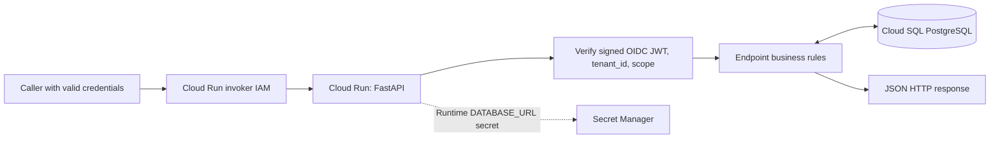

# LSK AI Access Operations Platform

Independent portfolio lab: fictional LSK IAM. Not evidence of an actual employer deployment.

GCP target: FastAPI, PostgreSQL, Cloud Run, Cloud SQL, Secret Manager, Artifact Registry, Terraform, GitHub Actions WIF.

## Security
OIDC-signed JWT, tenant and scope isolation, no payment processing, synthetic data. Restrict Cloud Run invoker IAM. Do not commit secrets.

## Cost
Create a billing budget first. Cloud SQL is charged while running. Budget alerts do not cap spending. No infrastructure is automatically deployed by this repository.

## Development
Run pip install -r requirements-dev.txt and DATABASE_URL=sqlite+pysqlite:///./test.db python -m pytest -q . See docs/ for design, operating risks, and interview guidance.


---

## Shared GCP request path

The diagrams below describe the **deployed configuration**, not a claim that this repository is currently running in Google Cloud. The local Docker Compose environment substitutes a local PostgreSQL container for Cloud SQL.



**Trust boundaries and components:** Cloud Run IAM determines whether a principal may invoke the deployed service. FastAPI **separately** checks a signed RS256 OIDC access JWT (issuer, audience, expiry, subject, tenant, and required scopes). An invoker identity token alone is not a substitute for the application's access token. Pydantic validates request bodies; the SQLAlchemy session reads/writes PostgreSQL with tenant filters. The application returns a synchronous JSON response. Terraform configures the Cloud Run runtime service account, Cloud SQL connection, Secret Manager and Artifact Registry; GitHub Actions builds/publishes containers through Workload Identity Federation. These CI/deployment components are **not** invoked by normal customer API calls.

**Operational endpoints:** `GET /healthz` responds without querying the database; `GET /readyz` queries the database. A local schema bootstrap is provided by `scripts/migrate.py`, not by incoming requests. Schema bootstrap is not a reviewed Alembic migration strategy.

**No frontend UI is included.** Use an authorized REST client or the FastAPI OpenAPI interface for the lab. No live employer integrations, real customer data, or real funds are involved.

## Business workflow: request access, obtain review, and inspect the audit trail

**Use case:** An employee requests corporate application access. An independent reviewer approves the **request record**, not an external IAM grant. Optional Gemini advice is informational.

```mermaid
sequenceDiagram
  autonumber
  participant U as Employee
  participant I as Cloud Run IAM
  participant A as FastAPI / OIDC
  participant DB as Cloud SQL PostgreSQL
  participant M as Vertex AI Gemini (optional)
  participant R as Independent reviewer
  U->>I: POST /v1/access-requests
  I->>A: Permit invoker
  A->>A: Verify access:request + tenant + allowed permission
  A->>DB: INSERT access_requests pending + audit requested
  DB-->>A: Commit request ID
  A-->>U: 201 {id,status:pending}
  opt Authorized read-only AI advisory
    U->>A: GET /v1/access-requests/{id}/ai-advisory
    A->>A: Require access:analyze + same tenant
    A->>M: Reduced resource label + requested permission
    M-->>A: Security suggestion, not approval
    A-->>U: advisory + automated_decision=false
  end
  R->>I: POST /v1/access-requests/{id}/approve
  I->>A: Permit invoker
  A->>A: Require access:approve and different requester
  A->>DB: Lock pending request; set approved + audit approved
  DB-->>A: Commit reviewer identity
  A-->>R: 200 {status:approved,provisioned:false}
  R->>A: GET /v1/audit
  A->>DB: SELECT tenant-scoped events
  DB-->>A: Requested and approved events
  A-->>R: Audit JSON
```

### Component-by-component behavior

| Stage | Code/component | Action and guardrail | Result |
|---|---|---|---|
| 1 | Cloud Run IAM + FastAPI `get_principal()` | Invoker IAM followed by signed JWT verification | Allowed tenant and subject |
| 2 | `AccessRequestNew` / `request_access()` | Validate resource, justification and permission in `viewer`, `editor`, `operator` | New `pending` request |
| 3 | `AccessRequest` + `AuditEvent` tables | Store request and `requested` audit event in one DB transaction | Durable request ID |
| 4 | Optional `advisory()` -> `app/ai.py` | Requires `access:analyze`; query request in same tenant | Model-generated security advice only |
| 5 | Vertex AI Gemini (optional) | Receives requested permission and truncated resource label; no identity or justification in prompt | Advisory text; may fail when model unavailable |
| 6 | `approve()` | Requires `access:approve`; row lock; requester cannot approve their own request; must be pending | `approved` status and reviewer identity |
| 7 | `audit()` | Requires `access:audit`; tenant-filtered event list | Request/approval audit entries |

### API example

```http
POST /v1/access-requests
Authorization: Bearer <OIDC_ACCESS_JWT>
Content-Type: application/json

{"resource":"finance-reporting","permission":"viewer","justification":"Read monthly close reports"}
```

The API responds with a request `id` and `status:"pending"`. A **different authorized user** invokes:

```http
POST /v1/access-requests/REQUEST_ID/approve
Authorization: Bearer <REVIEWER_OIDC_ACCESS_JWT>
```

It returns `{"id":"...","status":"approved","provisioned":false}`. The reviewer can use `GET /v1/audit` to inspect tenant events. For advisory, call `GET /v1/access-requests/REQUEST_ID/ai-advisory` using `access:analyze`.

### Failure behavior and boundaries

- Missing JWT/invalid signature: 401; insufficient scope or missing tenant: 403.
- Invalid permission: 422. Cross-tenant or unknown request: 404.
- Self approval: 403; duplicate approval or non-pending state: 409.
- No Vertex AI configuration: 503; model failure: 502. Access review works without an AI response.
- **Not implemented:** identity provider group grants, IAM provisioning or revocation, periodic access recertification, approval expiry, full request lifecycle, or AI autonomous remediation. This approval changes only **local database state**.
- The model returns **untrusted explanatory text**, not a policy decision. It does not execute tools or issue permissions.


## Brixton JD alignment

See [capability review and acceptance criteria](docs/JD_ALIGNMENT.md). LSK is a fictional portfolio company; employer deployments are not represented.


## Multinational deployment safeguards

The LSK reference deployment supports an explicit region/tenant authorization gate and configurable Cloud SQL HA sizing. Read the [multinational operating standard](docs/MULTINATIONAL_DEPLOYMENT.md) before creating regional stacks. No automatic cross-region replication or failover is configured; regional legal approval, private connectivity and operational testing remain mandatory.

## Database migration process (updated)

This repository now uses **versioned Alembic migrations**, not `Base.metadata.create_all()` for cloud initialization. A dedicated PostgreSQL 16 CI job verifies the baseline schema and database-specific constraints. Run `python scripts/migrate.py` in a separately approved one-off job, **before** routing application traffic, and record the revision through `python -m alembic current`. For an existing database created by the earlier bootstrap, use the [brownfield migration checklist](docs/SCHEMA_MIGRATION.md) before changing it. Production deployment also requires backup/restore, private network, controlled change release and legal/region reviews.

## Private regional database connectivity

An opt-in [private Cloud SQL + Direct VPC egress deployment](docs/PRIVATE_DATABASE_NETWORK.md) is available. Set `enable_private_sql=true` with a reviewed non-overlapping subnet CIDR. A `prod` Terraform plan now **requires** private SQL, REGIONAL HA and a non-micro Cloud SQL tier. This is still a lab reference until a real GCP plan/apply, approved security review, failover test and backup restore have been completed.


## Optional private GKE Kubernetes infrastructure

The independent [GKE Terraform module and deployment runbook](docs/KUBERNETES_INFRASTRUCTURE.md) provisions a reusable regional private GKE control plane, VPC-native pod/service networking, Cloud NAT, IAM and Workload Identity, Shielded Nodes and managed, autoscaled node pools. Source lives in `modules/gke/`; the cluster root is `infra/kubernetes/`. Choose `environments/kubernetes/{dev,staging,prod}.tfvars`; run the protected **GKE Kubernetes environment plan and apply** workflow after setting dedicated regional state and credentials.

This is a **separate deployment option** from the Cloud Run architecture in `infra/`. The Terraform module provisions Kubernetes infrastructure but **does not install or release the business application**; its ingress, workload identity bindings, external secrets, policy admission, runtime observability and GitOps release remain independent acceptance gates. Kubernetes infrastructure has been schema-validated in CI, not provisioned in GCP.
