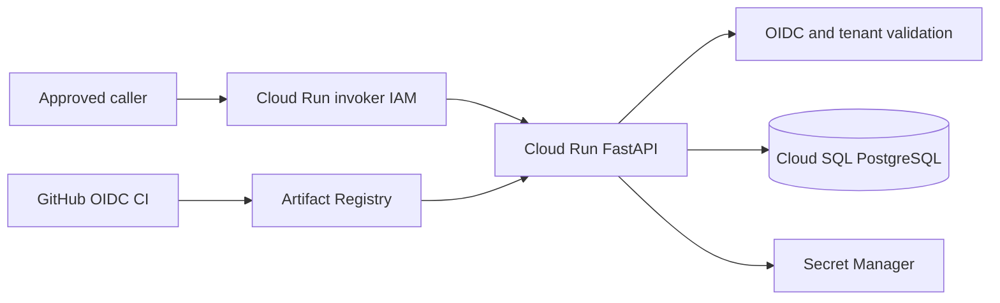

# GCP architecture

Cloud Run IAM controls who can invoke the API; a separate signed JWT controls tenant and API scopes. The lab is intentionally limited and is NOT PCI compliant or production certified.

## Gemini model advice

The optional Vertex/Gemini integration uses the Google Gen AI SDK with a Cloud Run runtime service identity and project-scoped `roles/aiplatform.user`. The LLM receives a reduced resource label and requested permission, not an employee identity or justification. All policy decisions and approvals remain deterministic and require a distinct human approver. Model responses are non-authoritative, subject to prompt-injection risk, and must never become permissions or IAM calls. Set `genai_model` explicitly to an available approved model and monitor token costs.
